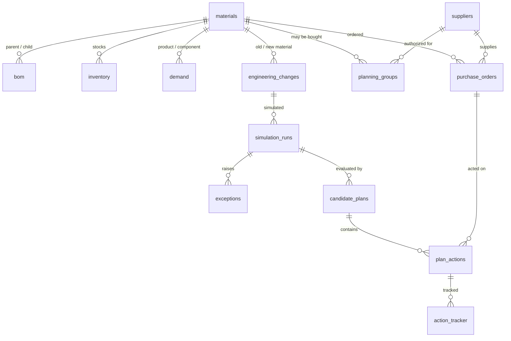

# Database documentation

SQLite file `database/changewise.db`, built by `python -m database.initialize_db` from `database/schema.sql` and `data/synthetic/*.csv`. The build drops and recreates the file, so it is repeatable. All CSVs load in **one transaction**: a bad row rolls back every table. No credentials are needed or stored.

## Relationships

## Tables

| # | Table | Owner (writes) | Key | Integrity rules |
|---|---|---|---|---|
| 1 | engineering_changes | M1 | change_id | FK old/new material; effective/use-up ≥ 1; old ≠ new revision; status enum |
| 2 | materials | M1 | material_id | revision `GLOB 'Rev [A-Z]'`; type/status enums; unit_cost ≥ 0 |
| 3 | bom | M1 | bom_id | FKs; qty > 0; parent ≠ child; unique (parent, child, effective_from). Cycles are caught in validation |
| 4 | inventory | M1 | inventory_id | FK; on_hand, reserved, safety ≥ 0; reserved ≤ on_hand; unique (material, plant, date) |
| 5 | demand | M1 | demand_id | FKs; week ≥ 1; qty ≥ 0; unique (product, material, plant, week) |
| 6 | purchase_orders | M1 | po_id | FKs; qty ≥ 0; arrival ≥ 1; status enum; fees ≥ 0; expedited 0/1 |
| 7 | suppliers | M1 | supplier_id | status ∈ Approved/Blocked/Unqualified; lead times ≥ 0 |
| 8 | planning_groups | M1 | (group, material, supplier) | FKs; authorization enum |
| 9 | candidate_plans | M2 | (optimization_run_id, plan_id) | feasibility enum; shortage/costs ≥ 0; rank ≥ 1 |
| 10 | plan_actions | M2 | action_id | composite FK to candidate_plans; 8 action types; FK PO/supplier |
| 11 | exceptions | M1 | (simulation_id, exception_id) | score 0–100; level enum; status enum |
| 12 | action_tracker | M3 | tracker_id | FK plan_actions; status enum |
| 13 | audit_log | M3 | event_id | **append-only** (triggers abort UPDATE/DELETE); hash chain |
| 14 | simulation_runs | M1 | simulation_id | FK change; status enum; stores full result JSON |

Indexes: `bom(child_material_id)` for where-used lookups, `bom(parent_material_id)`, `inventory(material_id)`, `demand(material_id, week)`, `purchase_orders(material_id)`, `purchase_orders(supplier_id)`, `simulation_runs(change_id)`, `exceptions(change_id)`.

`PRAGMA foreign_keys = ON` is set on every connection by `database/connection.py`, because SQLite does not enforce foreign keys otherwise.

`simulation_id` is derived from the input hash, so re-running identical inputs maps to the same row (`INSERT OR IGNORE`). That is the audit-replay property: a replay that produces a new id means the inputs or the engine changed.
